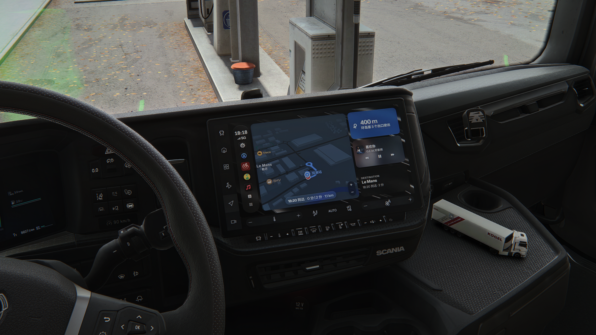
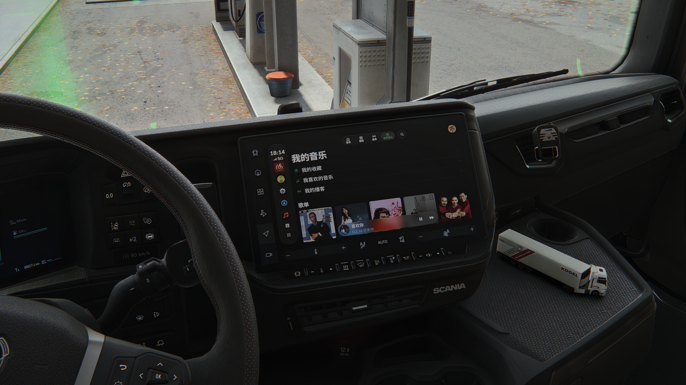
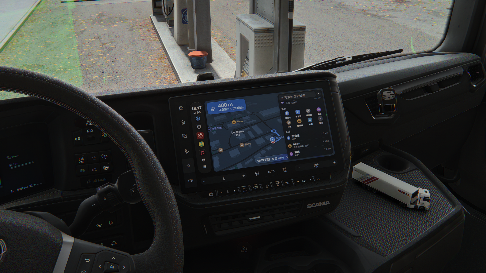
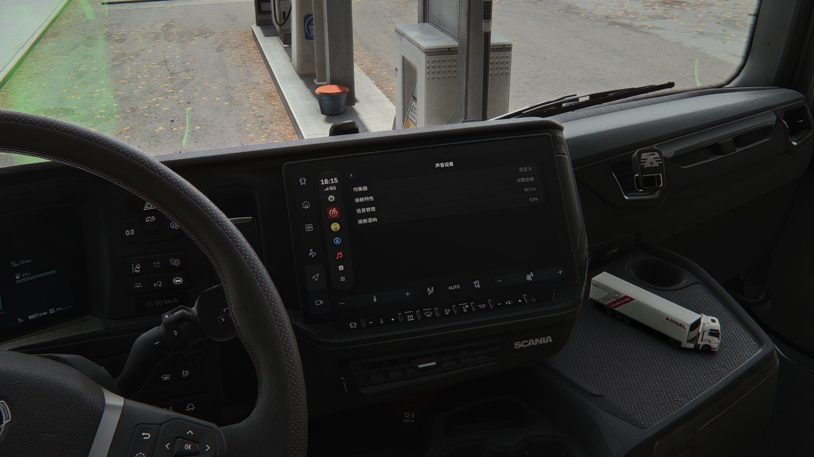

<div align="center">


# WestPlay-CN

**Unofficial Enhanced Fork with Chinese Music Services**

[](LICENSE)
[](https://github.com/lingbz112/WestPlay-CN/releases)
[](https://github.com/enes-less/WestPlay)

**English** | [中文说明](README.md)

</div>

---

## About

**WestPlay-CN** is a personal maintenance fork of the excellent [WestPlay](https://github.com/enes-less/WestPlay) project created by [enes-less](https://github.com/enes-less). A CarPlay-like player designed specifically for ETS2. This fork focuses on **Chinese music-service integrations**, **Chinese localization**, and **enhanced cabin audio experiences**.

The core application architecture and features are entirely thanks to the original author's outstanding work.

## Features

### Chinese Music Services Integration
Seamless integration with popular Chinese streaming platforms using the native in-vehicle music-app interaction model. Current integrations include:

- **QQ Music** 
- **NetEase Cloud Music**

**More platforms will be added progressively.**

### Chinese Localization
- Chinese language interface
- Optimized for Chinese music services with proper metadata handling

### Enhanced Cabin Audio
- Cabin EQ/IR
- Independent Reverb
- Fixed-Direction Early Reflections
- Directionless Bass Management
- 15-Band Advanced Equalizer

**Make music sound like it's playing in a real cockpit.**

### Global Keyboard Shortcuts
- Play/Pause
- Previous Track
- Next Track
- Volume Up
- Volume Down

**Control your music without switching windows.**

## Screenshots

### Home Page


### NetEase Cloud Music


### Chinese Maps


### Audio Settings


## Installation

### From Releases (Recommended)

Download the latest release from the **[Releases](https://github.com/lingbz112/WestPlay-CN/releases)** page.

#### Quick Start

1. Download the installer (`.msi` or `.exe`) from the Releases page
2. Run the installer and follow the setup wizard
3. Launch WestPlay-CN

For update notes and known issues, see the release notes on the Releases page.

### Build from Source

#### Prerequisites

- [Rust](https://www.rust-lang.org/tools/install) (latest stable version)
- [Node.js](https://nodejs.org/) (v18 or later)
- npm or pnpm

#### Build Steps

```bash
# Clone the repository
git clone https://github.com/lingbz112/WestPlay-CN.git
cd WestPlay-CN

# Install dependencies
npm install

# Build the application
npm run build
```

The built installer will be in the `target/release/bundle/` directory.

## Versioning

This fork uses a versioning scheme that tracks the upstream project:

- **Fork release tag format**: `v<upstream-version>-<revision>`
- Example: `v2.1.4-1`, `v2.1.4-2` for first and second releases based on upstream `2.1.4`
- When upstream advances (e.g., to `2.1.5`), revision counter restarts at `1`

This ensures you can always identify which upstream version a fork release is based on.

---

<div align="center">

**[⬆ Back to Top](#westplay-cn)**

Made with ❤️ for the community

</div>

---

<small>

This project follows the upstream WestPlay license: **GNU General Public License v3.0 or later (GPL-3.0-or-later)**. Original project copyright belongs to its original author and contributors. Changes in this fork are also distributed under GPL-3.0-or-later. See [`LICENSE`](LICENSE) for full terms. Third-party components: [`THIRD_PARTY_LICENSES.md`](THIRD_PARTY_LICENSES.md) and [`THIRD_PARTY_NOTICES.md`](THIRD_PARTY_NOTICES.md).

This is an **unofficial community fork**. It is not affiliated with, authorized by, partnered with, or endorsed by the original WestPlay author, Tencent, QQ Music, NetEase, NetEase Cloud Music, Apple, Apple Music, Spotify, YouTube, YouTube Music, Amazon, Amazon Music, or any other music service providers and their affiliates. All music service names, icons, trademarks, and related assets remain the property of their respective owners. Their inclusion in this repository identifies the compatible service only and does not grant a license under GPL.

Music service accounts, content, and usage are subject to each service's terms of service and applicable law. This project **does not** provide music content, bypass payment, copyright protection, or access controls. This project **does not** grant any rights to third-party content. The web player is not a stable public integration interface — upstream changes may break functionality. User login information and cookies remain in the local WebView2 profile and are **never uploaded** to any external server. WestPlay-CN does not have its own server.

The software is provided "as is", without express or implied warranty. The maintainer is not liable for losses resulting from use of this software.

</small>