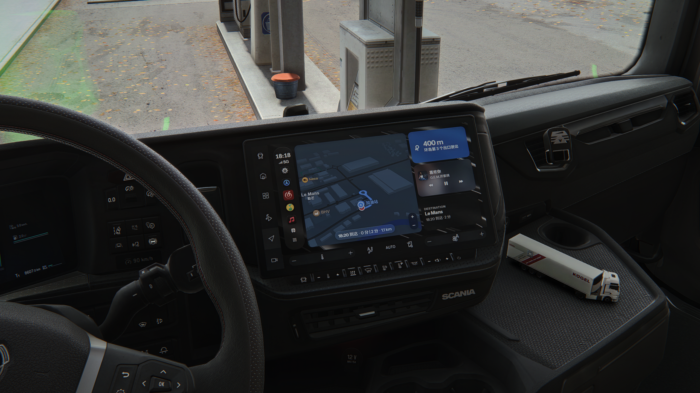
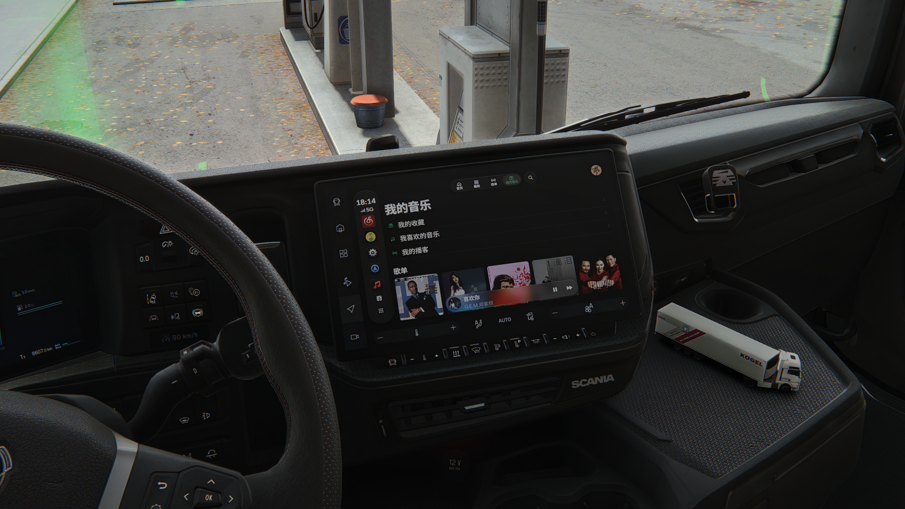
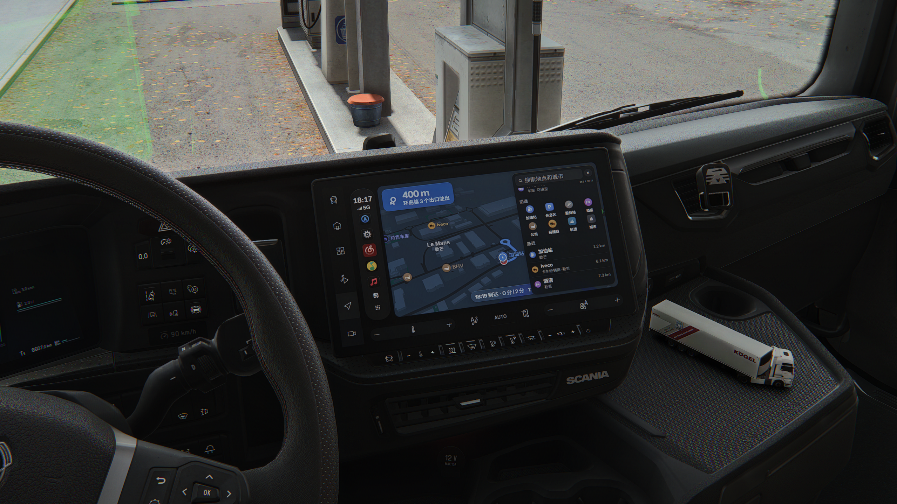
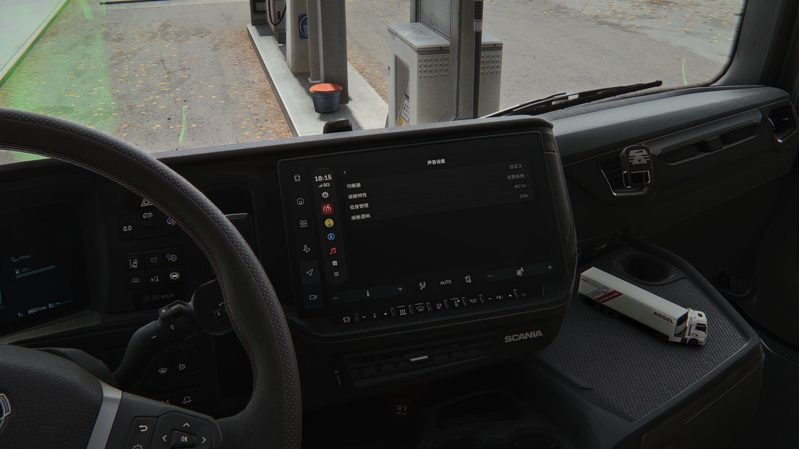

<div align="center">


# WestPlay-CN

**非官方增强分支 · 集成国内音乐平台**

[](LICENSE)
[](https://github.com/lingbz112/WestPlay-CN/releases)
[](https://github.com/enes-less/WestPlay)

[English](README.en.md) | **中文说明**

</div>

---

## 简介

**WestPlay-CN** 是由 [enes-less](https://github.com/enes-less) 创建的优秀 [WestPlay](https://github.com/enes-less/WestPlay) 项目的个人维护分支。一款专为ETS2设计的、类似于CarPlay的播放器。本分支专注于**中国音乐平台集成**、**中文本地化**和**车舱音频增强**。

本应用优秀的基础架构和核心功能完全得益于原作者的杰出工作。

## 特性

###  中国音乐平台集成
采用原生车机音乐应用交互模型，无缝集成国内主流流媒体平台。目前支持的集成包括：

- **QQ音乐** 
- **网易云音乐**

**更多平台将持续添加。**

###  中文本地化
- 中文界面
- 针对国内音乐服务优化元数据处理

###  车舱音频增强
- 车舱EQ/IR
- 独立混响
- 固定方向早期反射
- 无方向性低音管理
- 15段高级均衡器

**让音乐听起来更像是在真实驾驶舱播放的一样。**

###  全局快捷键
- 播放/暂停
- 上一曲
- 下一曲
- 音量加
- 音量减

**无需切换窗口即可控制音乐。**

##  应用截图

### 主页面


### 网易云音乐


### 中文地图


### 音频设置


##  安装

### 从 Releases 下载（推荐）

从 **[Releases](https://github.com/lingbz112/WestPlay-CN/releases)** 页面下载最新版本。

#### 快速开始

1. 从 Releases 页面下载安装包（`.msi` 或 `.exe`）
2. 运行安装程序，按照安装向导完成安装
3. 启动 WestPlay-CN

更新说明和已知问题请查看 Releases 页面的发布说明。

### 从源代码构建

#### 前置要求

- [Rust](https://www.rust-lang.org/tools/install)（最新稳定版）
- [Node.js](https://nodejs.org/)（v18 或更高版本）
- npm 或 pnpm

#### 构建步骤

```bash
# 克隆仓库
git clone https://github.com/lingbz112/WestPlay-CN.git
cd WestPlay-CN

# 安装依赖
npm install

# 构建应用
npm run build
```

构建完成的安装包位于 `target/release/bundle/` 目录中。

##  版本规则

本分支采用上游项目的版本号规则：

- **分支发布标签格式**：`v<上游版本>-<修订号>`
- 示例：`v2.1.4-1`、`v2.1.4-2` 分别表示基于上游 `2.1.4` 的第1、第2个发布版
- 上游版本升级后（如升级到 `2.1.5`），修订号从 `1` 重新开始

这确保您可以随时识别一个分支版本基于哪个上游版本。

---

<div align="center">

**[⬆ 返回顶部](#westplay-cn)**

用 ❤️ 为社区制作

</div>

---

<small>

本项目沿用上游 WestPlay 的许可证：**GNU General Public License v3.0 or later (GPL-3.0-or-later)**。原项目版权归其原作者和贡献者所有，本分支修改部分同样按 GPL-3.0-or-later 分发。完整条款见 [`LICENSE`](LICENSE)。第三方组件：[`THIRD_PARTY_LICENSES.md`](THIRD_PARTY_LICENSES.md) 和 [`THIRD_PARTY_NOTICES.md`](THIRD_PARTY_NOTICES.md)。

这是**非官方社区分支**，与原WestPlay作者、腾讯/QQ音乐、网易/网易云音乐、Apple/Apple Music、Spotify、YouTube/YouTube Music、Amazon/Amazon Music 及其他任何音乐服务提供商及其关联公司没有隶属、授权、合作或背书关系。所有音乐服务的名称、图标、商标和相关资产归各自权利人所有。本仓库中的名称或图标仅用于识别兼容服务，不构成 GPL 授权。

音乐服务账号、内容和使用方式受各服务的服务条款及适用法律约束。本项目**不**提供音乐内容，**不**绕过付费、版权保护或访问控制，也**不**授予任何第三方内容的使用权。网页播放器不是稳定的公开接口 —— 上游变化可能导致功能失效。用户登录信息和 cookie 保存在本地 WebView2 配置中，**从未上传**到任何外部服务器，WestPlay-CN 也没有自己的服务器。

软件按"现状"提供，不附带明示或默示担保。维护者不对使用本软件造成的损失承担责任。

</small>